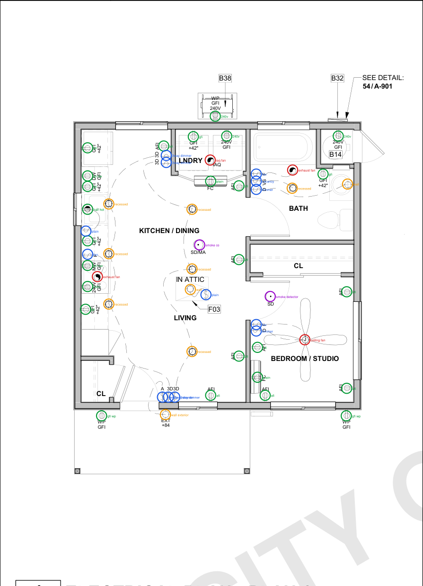
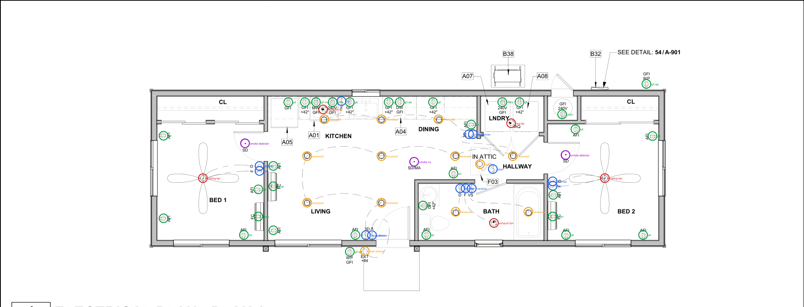
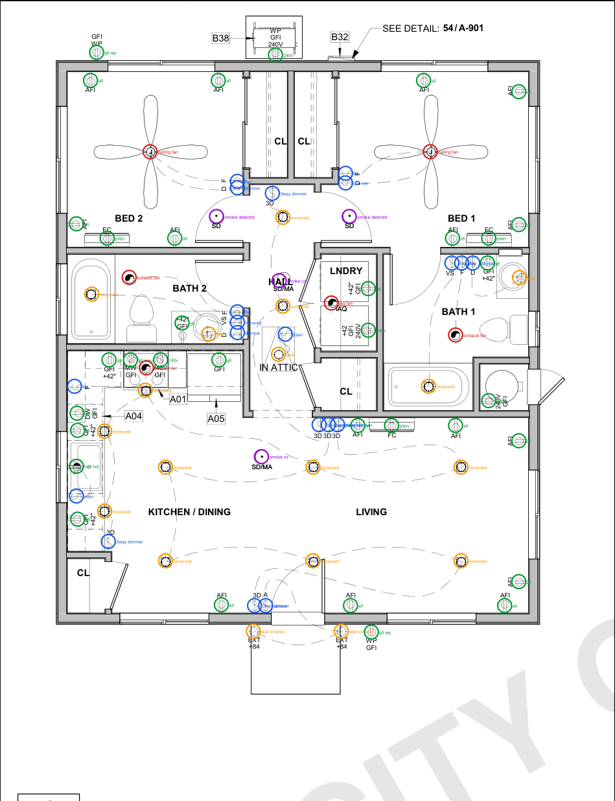
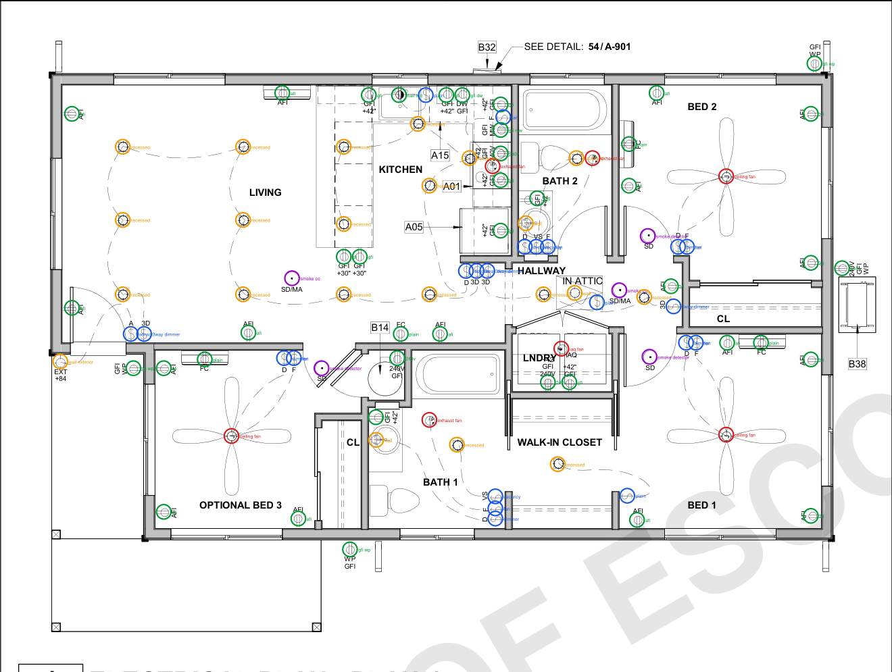

# The answer key: what every number is scored against

No public dataset has verified counts for these plans, so this one was built for the project. Files: eval/answer_key/<sheet>.json (one entry per device: type, centre in PDF points, room).

| Step | Who / what | When |
|---|---|---|
| Geometry matcher counted every sheet from the PDF's own strokes | code: takeoff/methods/geometry.py | 2026-10-27 |
| Claude read every plan with its legend | Claude Opus 5.5 via `claude -p` | 2026-10-28 |
| Every place the two disagreed was settled by eye on a zoomed crop of the vector PDF | Claude Opus 5.5 (the coding assistant), crops kept in the author's notes | 2026-10-28 |
| Rooms checked against the wall-and-label room finder; 19 differences looked at: 3 fixed, 12 open-plan or unlabelled spots marked 'either room', 4 kept | Claude Opus 5.5, crops of each spot | 2026-10-28 |
| Seven independent runs lined up against the key (five one-shot coding agents, Claude and Codex; vision-consensus; geometry); every entry most of them disputed was zoomed: 1 device added, 2 attic lights accept pendant or wall | Claude Opus 5.5; runs in eval/oneshot/runs/ | 2026-10-28 |
| Checked by a person (an estimator or the author) | not done yet | - |

A device that every method missed is not in the key. That is why the person check matters.

## A1-111: 55 devices

4 fans · 10 lights · 13 switches · 26 receptacles · 2 detectors

| Room | Fans | Lights | Switches | Receptacles | Detectors | Total |
|---|---|---|---|---|---|---|
| BATH | 1 (1 exhaust fan) | 2 (1 recessed, 1 wall) | 3 (1 dimmer, 1 fan, 1 vacancy) | 2 (1 240v, 1 gfi) |  | 8 |
| BEDROOM / STUDIO | 1 (1 ceiling fan) |  | 2 (1 dimmer, 1 fan) | 5 (1 plain, 4 afi) | 1 (1 smoke detector) | 9 |
| KITCHEN / DINING | 1 (1 exhaust fan) | 5 (5 recessed) | 4 (1 plain, 2 3way dimmer, 1 fan) | 10 (1 240v, 2 afi, 4 gfi, 1 gfi dw, 1 gfi mw, 1 half hot) | 1 (1 smoke co) | 21 |
| LIVING |  | 2 (1 recessed, 1 wall) | 4 (1 plain, 2 3way dimmer, 1 sensor) | 3 (3 afi) |  | 9 |
| LNDRY | 1 (1 iaq fan) |  |  | 3 (1 plain, 1 240v, 1 gfi) |  | 4 |
| Exterior |  | 1 (1 wall exterior) |  | 3 (1 240v, 2 gfi wp) |  | 4 |

Either room accepted: plain receptacle at (1146, 287) LNDRY or KITCHEN / DINING; recessed light at (1005, 457) KITCHEN / DINING or LIVING; afi receptacle at (1185, 395) LIVING or KITCHEN / DINING.

## A2-111: 66 devices

5 fans · 13 lights · 13 switches · 32 receptacles · 3 detectors

| Room | Fans | Lights | Switches | Receptacles | Detectors | Total |
|---|---|---|---|---|---|---|
| BATH | 1 (1 exhaust fan) | 2 (2 recessed) | 3 (1 dimmer, 1 fan, 1 vacancy) | 2 (1 afi, 1 gfi) |  | 8 |
| BED 1 | 1 (1 ceiling fan) |  | 2 (1 dimmer, 1 fan) | 5 (1 plain, 4 afi) | 1 (1 smoke detector) | 9 |
| BED 2 | 1 (1 ceiling fan) |  | 2 (1 dimmer, 1 fan) | 6 (1 plain, 5 afi) | 1 (1 smoke detector) | 10 |
| DINING |  | 2 (2 recessed) | 2 (1 plain, 1 3way dimmer) | 2 (1 afi, 1 gfi) |  | 6 |
| HALLWAY |  | 2 (1 recessed, 1 wall) | 1 (1 plain) | 2 (1 240v, 1 afi) |  | 5 |
| KITCHEN | 1 (1 exhaust fan) | 3 (3 recessed) | 1 (1 fan) | 7 (1 240v, 4 gfi, 1 gfi dw, 1 gfi mw) |  | 12 |
| LIVING |  | 3 (3 recessed) | 2 (1 3way dimmer, 1 sensor) | 4 (1 plain, 3 afi) | 1 (1 smoke co) | 10 |
| LNDRY | 1 (1 iaq fan) |  |  | 2 (1 240v, 1 gfi) |  | 3 |
| Exterior |  | 1 (1 wall exterior) |  | 2 (2 gfi wp) |  | 3 |

Either room accepted: recessed light at (638, 289) LIVING or KITCHEN; smoke co detector at (811, 298) LIVING or DINING; afi receptacle at (874, 317) HALLWAY or DINING; 240v receptacle at (1050, 222) HALLWAY or LNDRY.

## A3-111: 82 devices

6 fans · 18 lights · 20 switches · 34 receptacles · 4 detectors

| Room | Fans | Lights | Switches | Receptacles | Detectors | Total |
|---|---|---|---|---|---|---|
| BATH 1 | 1 (1 exhaust fan) | 2 (1 recessed, 1 wall) | 3 (1 dimmer, 1 fan, 1 vacancy) | 2 (1 240v, 1 gfi) |  | 8 |
| BATH 2 | 1 (1 exhaust fan) | 2 (1 recessed, 1 wall) | 3 (1 dimmer, 1 fan, 1 vacancy) | 1 (1 gfi) |  | 7 |
| BED 1 | 1 (1 ceiling fan) |  | 2 (1 dimmer, 1 fan) | 5 (1 plain, 4 afi) | 1 (1 smoke detector) | 9 |
| BED 2 | 1 (1 ceiling fan) |  | 2 (1 dimmer, 1 fan) | 5 (1 plain, 4 afi) | 1 (1 smoke detector) | 9 |
| HALL |  | 3 (2 recessed, 1 wall) | 2 (1 plain, 1 3way dimmer) |  | 1 (1 smoke co) | 6 |
| KITCHEN / DINING | 1 (1 exhaust fan) | 5 (5 recessed) | 5 (1 plain, 2 3way dimmer, 1 fan, 1 sensor) | 9 (1 240v, 1 afi, 4 gfi, 1 gfi dw, 1 gfi mw, 1 half hot) | 1 (1 smoke co) | 21 |
| LIVING |  | 4 (4 recessed) | 3 (3 3way dimmer) | 7 (1 plain, 6 afi) |  | 14 |
| LNDRY | 1 (1 iaq fan) |  |  | 2 (1 240v, 1 gfi) |  | 3 |
| Exterior |  | 2 (2 wall exterior) |  | 3 (1 240v, 2 gfi wp) |  | 5 |

## A4-111: 97 devices

7 fans · 22 lights · 22 switches · 41 receptacles · 5 detectors

| Room | Fans | Lights | Switches | Receptacles | Detectors | Total |
|---|---|---|---|---|---|---|
| BATH 1 | 1 (1 exhaust fan) | 2 (1 recessed, 1 wall) | 3 (1 dimmer, 1 fan, 1 vacancy) | 1 (1 gfi) |  | 7 |
| BATH 2 | 1 (1 exhaust fan) | 2 (1 recessed, 1 wall) | 3 (1 dimmer, 1 fan, 1 vacancy) | 1 (1 gfi) |  | 7 |
| BED 1 | 1 (1 ceiling fan) |  | 3 (1 plain, 1 dimmer, 1 fan) | 5 (1 plain, 4 afi) | 1 (1 smoke detector) | 10 |
| BED 2 | 1 (1 ceiling fan) |  | 2 (1 dimmer, 1 fan) | 5 (1 plain, 4 afi) | 1 (1 smoke detector) | 9 |
| HALLWAY |  | 3 (2 recessed, 1 wall) | 2 (1 plain, 1 3way dimmer) | 2 (1 240v, 1 afi) | 2 (1 smoke co, 1 smoke detector) | 9 |
| KITCHEN | 1 (1 exhaust fan) | 7 (7 recessed) | 5 (1 plain, 2 3way dimmer, 1 dimmer, 1 fan) | 11 (1 240v, 7 gfi, 1 gfi dw, 1 gfi mw, 1 half hot) |  | 24 |
| LIVING |  | 6 (6 recessed) | 2 (1 3way dimmer, 1 sensor) | 6 (1 plain, 5 afi) | 1 (1 smoke co) | 15 |
| LNDRY | 1 (1 iaq fan) |  |  | 2 (1 240v, 1 gfi) |  | 3 |
| OPTIONAL BED 3 | 1 (1 ceiling fan) |  | 2 (1 dimmer, 1 fan) | 4 (1 plain, 3 afi) |  | 7 |
| WALK-IN CLOSET |  | 1 (1 recessed) |  |  |  | 1 |
| Exterior |  | 1 (1 wall exterior) |  | 4 (1 240v, 3 gfi wp) |  | 5 |

Either room accepted: plain receptacle at (1395, 360) LIVING or KITCHEN; afi receptacle at (1433, 360) LIVING or KITCHEN; recessed light at (1340, 322) KITCHEN or LIVING; smoke detector detector at (1318, 394) HALLWAY or OPTIONAL BED 3; 240v receptacle at (1392, 384) HALLWAY or CL.

Colours on the pictures: red fans, orange lights, blue switches, green receptacles, purple detectors.
